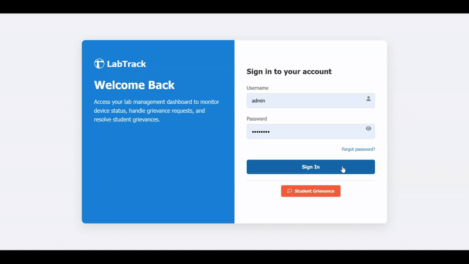
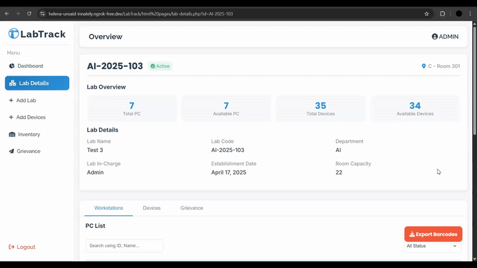

# LabTrack
### Computer Lab Monitoring System

[](https://github.com/Ompatil39/LabTrack/actions/workflows/ci.yml)
[](phpstan.neon)
[](tests/)
[](LICENSE)
[](https://php.net)
[](https://github.com/Ompatil39/LabTrack/issues)

---

## Overview

LabTrack is a web-based laboratory monitoring and management system designed for educational institutions to streamline the administration of computer labs and their resources. Built with PHP, HTML, CSS, and JavaScript, the system provides role-based access for Admins and Lab In-charges to manage labs, track devices, and handle grievances efficiently. Admins can register labs with auto-generated lab codes, assign Lab In-charges, and maintain an updated inventory of devices including PCs, printers, and peripherals. The platform supports detailed device registration with specifications and quick entry features for faster management. A dedicated grievance management module allows students to report issues, while Admins and Lab In-charges can update statuses with automatic email notifications to keep students informed. With features like a dashboard for real-time insights, device search and filtering, and maintenance scheduling, LabTrack simplifies day-to-day operations while ensuring transparency and accountability in lab management.

---

## Demo Videos

### Complete System Walkthrough



### QR Code Feature Demo




---

## Features

  **Role-Based Access Control**  
  - Admin: Manage labs, devices, grievances, and Lab In-charges.  
  - Lab In-charge: Oversee assigned labs, update device records, and handle grievances.  

  **Dashboard**  
  - Displays real-time metrics such as total labs, active devices, resolved grievances, and pending grievances.  

  **Lab Management**  
  - Register new labs with auto-generated lab codes.  
  - Assign Lab In-charges and maintain lab details.  

  **Device Management (Inventory)**  
  - Add and manage devices such as PCs, printers, and peripherals.  
  - Store detailed specifications including monitor, keyboard, mouse, and CPU details.  
  - "Copy Last Entry" option for quick registration of similar devices.  

  **QR Code Integration**  
  - **Automatic QR Generation**: Each device is automatically assigned a unique QR code for easy identification.  
  - **QR Code Scanning**: Built-in scanner allows users to scan a device's QR code and instantly navigate to its detailed page in the system.  
  - **PDF Export with QR Codes**: Generate comprehensive PDF reports containing:
    * Basic lab details (lab name, code, statistics)
    * Structured table listing all devices with their unique QR codes
    * Perfect for offline use, printing, and quick reference
  - This feature improves device management, reduces manual searching, and makes lab operations more efficient.

  **Grievance Management**  
  - Students can submit issues or complaints.  
  - Admins and Lab In-charges can update grievance statuses.  
  - Automatic email notifications sent to students when grievance status changes.  

  **Security**  
  - Password hashing, input sanitization, CSRF protection, and prepared statements to prevent SQL injection.  
  - Session-based authentication with role-level access control.  

---

## Requirements

- **PHP**: 8.2 or higher
- **Web Server**: Apache 2.4+ or Nginx 1.18+
- **Database**: MySQL 5.7+ or MariaDB 10.3+
- **Extensions**: PDO, PDO_MySQL, JSON, CURL
- **Memory**: Minimum 512MB RAM
- **Storage**: At least 500MB free disk space

---

## Documentation & Architecture

- **Database Schema (PDF):** [docs/DB_schema.pdf](docs/DB_schema.pdf)
- **Database ER Diagram:** [docs/db.png](docs/db.png)

---

## Quick Start (Docker)

1. Copy the environment template:
   - `cp .env.example .env`
2. Start the application stack:
   - `docker compose up --build`
3. Open the application:
   - `http://localhost:8080/login`
4. Default seeded users:
   - Admin: `admin / admin123`
   - In-charges: `incharge_lab1 / incharge123`, `incharge_lab2 / incharge123`

The app container automatically runs migrations and deterministic seeding on startup. Optional phpMyAdmin is accessible at `http://localhost:8081`.

---

## Development & Quality Assurance

Run the complete test and static analysis suite locally:

```bash
# Run all CI checks (linting, static analysis, unit & feature tests)
composer ci

# Individual commands:
composer lint     # Check code style with PHP-CS-Fixer
composer format   # Automatically fix code style
composer stan     # Run PHPStan static analysis at Level 6
composer test     # Run PHPUnit test suite
```

### Database Migrations & Seeds

```bash
php bin/migrate.php       # Run all pending migrations
php bin/migrate.php down  # Roll back the most recent migration batch
php bin/seed.php          # Seed deterministic test/demo accounts & labs
```

---

## Usage

### Accessing the System
1. Navigate to your configured URL (e.g., `http://localhost/LabTrack`)
2. Login with default credentials:
   - **Username**: admin
   - **Password**: admin123
3. Change default password immediately after first login

---

## Security

- Password hashing using PHP's `password_hash()`
- SQL injection prevention with prepared statements
- XSS protection through input sanitization
- CSRF token validation
- Session-based authentication
---

## Phase 6: Monitoring Agent & Telemetry

LabTrack includes a lightweight Python monitoring daemon (`agent/labtrack_agent.py`) for automated host metrics collection, live status monitoring, and hardware drift detection.

### 1. Enrolling a Workstation Agent
1. In the Web UI as an Administrator, navigate to **Workstations** &rarr; select the target seat.
2. In the **Workstation Monitoring Agent** panel, click **Generate Enrollment Token** (valid for 24 hours, shown only once).
3. On the client machine, run:
   ```bash
   python agent/labtrack_agent.py --enroll --server https://YOUR-SERVER --token <ENROLLMENT_TOKEN>
   ```
4. Start continuous telemetry collection:
   ```bash
   # Run once to test:
   python agent/labtrack_agent.py --once --inventory

   # Run as continuous daemon (heartbeat every 60s, inventory every 24h):
   python agent/labtrack_agent.py
   ```
   On Windows, use `powershell -ExecutionPolicy Bypass -File agent/windows/install_service.ps1` to install as a startup task. On Linux, deploy `agent/systemd/labtrack-agent.service`.

### 2. Telemetry Retention & Rollups Job
To roll up completed hourly samples, purge raw telemetry samples older than 30 days, purge rollups older than 365 days, and prune expired nonces, run:
```bash
php bin/telemetry-retention.php
```
This script is idempotent and safe to schedule in cron (e.g. hourly or daily).

---

## License

This project is licensed under the MIT License - see the [LICENSE](LICENSE) file for details.

---

## Support

For support and questions:
- **Issues**: [GitHub Issues](https://github.com/Ompatil39/LabTrack/issues)

---

**LabTrack** - Computer Lab Monitoring Made Simple

*Developed by Om Patil*
